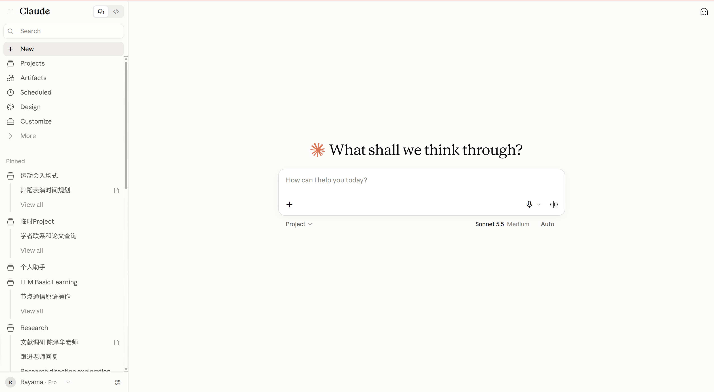
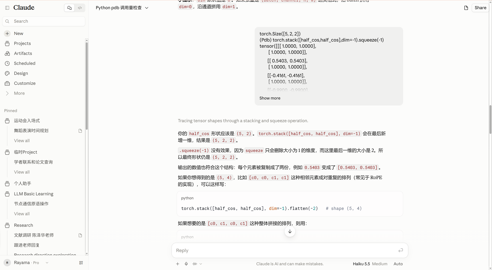

# Spec：网页界面

状态：待评审草案，2026-10-21 按 [ADR-0002](../adr/0002-think-google-drive.md) 更新（资料与 Artifacts 分开、引用改为原文摘录、Google Drive）。Mock 前端（M0）按本文实现，数据全部在浏览器内伪造，不代表任何后端行为已经实现或验证。

依据：[产品 Intent](../intents/personal-assistant.md)、[首版 Spec](personal-assistant.md)、[架构草案](../design/architecture.md)。

## 参考与取舍

界面形态参考 Claude 网页版：

| 首页 | 会话页 |
| --- | --- |
|  |  |

保留其左侧导航、居中输入框、阅读宽度受限的消息流和底部回复框。差异在于本产品的核心是**可持续的任务**，而不是一次性的流式回答，因此界面额外展示：

- 任务状态（排队、执行、完成、失败、已中断），关闭网页后再打开仍可见（S2、S4、S7）。
- 工具调用过程与结果，可展开查看参数和输出（S10）。
- 回答中的资料引用：显示文件名和原文摘录，点击后跳转到原文并高亮（S6）。
- Artifact：助手生成的产物在侧边面板预览，可保存到 Drive。
- 外部写操作前的确认卡片，绑定最终内容（邮件、ehall，后续阶段）。

不复制参考产品的品牌、Logo、语音输入、代码模式切换和分享到公网链接。

## 信息架构

```text
侧栏
├─ 新对话
├─ 搜索（会话标题与内容）
├─ 项目       一组会话 + 项目说明，可置顶
├─ 资料       用户自己的文件（Drive `GenseBot/资料/`）与 Artifacts（`GenseBot/Artifacts/`），两个标签页（S5）
├─ 定时任务   提醒与周期任务（后续阶段，M0 只展示）
├─ 定制       工具开关、记忆、偏好
├─ 置顶       置顶项目及其最近会话
├─ 最近       未归属项目的会话
└─ 账户       当前 Google 账号、Drive 连接状态、退出登录
主区
├─ 首页       问候语 + 输入框 + 项目、模型、effort 选择
├─ 会话页     标题栏 + 消息流 + 回复框
├─ 项目页     项目列表 / 单个项目的会话与说明
├─ 资料页     资料 / Artifacts 两个标签页 + 只读预览（高亮引用摘录）
├─ 定时任务页 列表、下一次执行时间、启用开关
└─ 定制页     工具、记忆、偏好三个分组
```

导航使用 URL hash（如 `#/c/<id>`），刷新后停留在同一页面，后端接入后可换成路径路由。

## 页面与组件要求

### 首页

- 居中标题与输入框，输入框支持多行，`Enter` 发送、`Shift+Enter` 换行，输入法组合输入期间不发送。
- 输入框下方：项目选择（默认无项目）、模型选择、effort（低 / 中 / 高）。模型列表由服务端从 Anthropic 和 OpenAI 两个兼容端点获取，按供应商分组显示；某个端点获取失败时，只显示它在 `.env` 中配置的默认模型。
- 首次登录、尚未连接 Google Drive 时，输入框上方显示“连接 Google Drive”提示条；未连接时仍可对话，但不能使用资料工具。
- 发送后创建会话并跳转到会话页，标题先取输入的前若干字，后续可由助手生成。

### 会话页

- 顶栏：会话标题与下拉菜单（重命名、置顶、移入项目、删除），右侧为“任务详情”按钮。M0 中删除需二次确认。
- 用户消息：右侧浅色气泡，超过一定高度折叠并显示“展开”。
- 助手消息：左侧无气泡正文，渲染 Markdown、表格、行内代码和代码块；代码块带语言标签和复制按钮。
- 过程摘要：助手回答上方一行灰色文字概括本轮做了什么，点击展开工具调用列表。每个工具调用显示名称、状态、耗时，展开可见参数与输出摘要。
- 插件界面：工具声明了界面（`resourceUri`）时，在消息流中渲染插件提供的组件（如 Artifact 卡片、邮件草稿）；没有声明的显示通用工具卡片。接口与 MCP Apps 对齐，见 [架构草案“插件与界面”](../design/architecture.md#插件与界面)。
- 引用：回答下方的引用卡片显示文件名和一段原文摘录（最多两行，可展开）。点击后跳到资料页并高亮摘录；找不到摘录时显示“原文已变化”，并给出当时保存的摘录。
- Artifact：助手生成产物时，正文中出现一张 Artifact 卡片（标题、类型）。点击后在右侧面板预览（手机上全屏），面板顶部有“保存到 Drive”“复制”和“关闭”。保存后卡片显示“已保存”，并提供“在 Drive 中打开”的链接。
- 任务状态：每一轮请求有独立状态。排队、执行中显示进度动画；失败显示可理解的原因（达到单轮步数上限、模型端点错误、平台额度已用尽、Drive 错误、工具不可用，见首版 Spec“兜底限制”）和“重试”按钮；重试生成新的请求，不复用失败请求。
- 生成中可点击“停止”。停止后状态为“已中断”，已产生的内容保留。
- 滚动离开底部时显示“回到底部”按钮。
- 回复框固定在底部，下方显示当前模型、effort 和“助手可能出错”提示。
- 确认卡片（后续阶段）：展示收件人、正文或表单关键字段及后果，按钮为“确认执行 / 修改 / 取消”。修改后必须重新确认。M0 用一张示例卡片演示交互，不执行任何操作。

### 资料页

- 两个标签页：**资料**（用户的文件）和 **Artifacts**（助手的产物）。列表显示文件名、大小、修改时间，以及“在 Drive 中打开”。
- 资料标签页提供“上传”和“从 Drive 选择”（Google Picker）。超过大小上限或类型不支持时给出明确提示（S5）。
- 预览为只读。从引用进入时高亮摘录所在段落并滚动到该处。
- 编辑和删除在 Drive 中进行，助手界面首版不提供。

### 定时任务页、定制页

- 定时任务：名称、触发规则、下一次执行时间、启用开关、最近一次结果。M0 开关只改本地状态。
- 定制：工具列表（名称、说明、是否有外部副作用、开关）；记忆条目列表（可编辑、删除）；偏好（回答语言、默认 effort）。M0 只改本地状态。

### 移动端

手机是第一入口（I2）。宽度小于 768px 时：

- 侧栏变为左侧抽屉，由顶栏菜单按钮打开，点击遮罩或选择条目后关闭。
- 回复框贴底并考虑安全区，消息区左右留白不少于 16px。
- 代码块与表格在自身容器内横向滚动，页面主体不横向滚动。
- 触控目标不小于 40px。

### 视觉

浅色暖白背景、橙色强调色、标题使用衬线字体、正文使用系统字体。支持系统深色模式。不使用参考产品的 Logo，使用本项目名 GenseBot。

## 数据模型草案

前端只依赖以下概念。字段是 M0 的 TypeScript 类型草案。接后端后，会话和轮次以 Think 持久化的消息为准，文件以 Drive 为准（见架构草案）。

| 概念 | 关键字段 | 说明 |
| --- | --- | --- |
| Project | id、name、description、pinned | 会话分组 |
| Conversation | id、title、projectId、pinned、updatedAt | 会话 |
| Turn | id、requestId、status、userMessage、assistantMessage、toolCalls、citations、artifacts、error | 一次请求及其结果；`requestId` 由前端生成，用于去重（S3） |
| ToolCall | id、name、status、args、output、durationMs | 工具调用记录 |
| Citation | fileId、name、quote | 引用：文件 + 原文摘录 |
| File | id、name、kind（`source` / `artifact`）、mimeType、size、modifiedTime、webViewLink | Drive 文件；内容按需读取 |
| Artifact | id、title、type（markdown / code / …）、content、savedFileId | 会话中的产物，保存后关联 Drive 文件 |
| Schedule | id、name、rule、nextRunAt、enabled、lastResult | 定时任务 |

Turn 的 `status` 取值：`queued`、`running`、`succeeded`、`failed`、`interrupted`。

## 交付阶段

| 阶段 | 内容 | 退出条件 |
| --- | --- | --- |
| M0 Mock 前端 | 本文全部页面与交互；数据存于浏览器 `localStorage`；回复由前端脚本模拟（含工具调用、引用、失败与中断） | 部署到 Cloudflare 免费计划，手机与桌面可完整走通演示流程 |
| M1 接入首个闭环 | Access 登录、Think 会话、Google Drive 资料与 Artifacts、用户自备模型 | 满足首版 Spec S1 至 S10 |
| M2 及以后 | smail 读取与草稿、定时任务、Google Calendar / Tasks、记忆编辑、ehall | 各自另写 Spec |

M0 已部署到 <https://gensebot-mock.rayama114514.workers.dev>（Worker `gensebot-mock`，仅静态资源，Free 计划）。M0 不做认证，部署地址任何人可访问，因此只放演示数据，不放个人资料。

## 待定

- 是否需要“任务详情”独立页面展示单轮步数与耗时。
- Artifact 的类型范围：首版只做 Markdown 和代码，HTML 预览是否需要（需要沙箱 iframe）。
